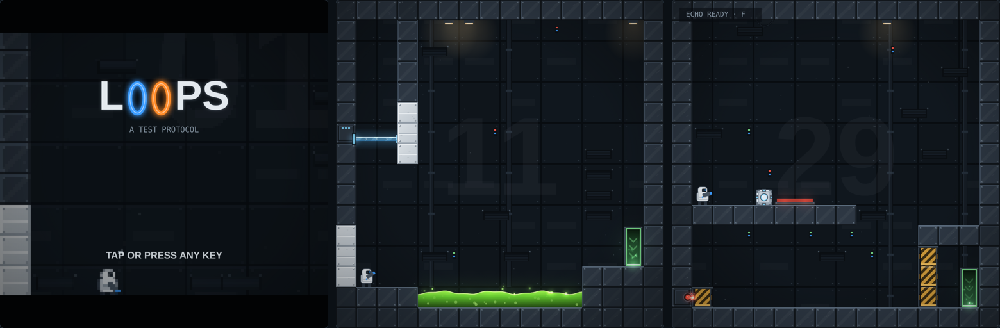

# Loops

*The facility never sleeps.*

**Deutsch** · [English](#english)

Ein 2D-Portal-Puzzlespiel im Browser. Zwei Portale, nahtlose Bewegung, eine sarkastische Testleitung und eine Reihe von Testkammern, die mehr verlangen, als sie zugeben.

Das ganze Spiel steckt in einer einzigen Datei, `index.html`, ohne Abhängigkeiten oder Build-Schritt. Einfach im Browser öffnen.

## Spielen

- **Lokal:** `index.html` herunterladen und im Browser öffnen.
- **Online:** über GitHub Pages (Settings → Pages → Branch `main`, Ordner `/`), oder die Datei bei itch.io / Netlify Drop hochladen.

## Steuerung

| | Tastatur & Maus | Touch | Gamepad |
|---|---|---|---|
| Laufen | A / D | linker Stick | linker Stick |
| Springen | W / Leertaste | „Sprung“ oder Stick nach oben | A |
| Blaues / oranges Portal | Links- / Rechtsklick | Portal-Tasten + rechter Stick | LB/LT · RB/RT |
| Pause-Menü | Esc | – | Start |
| Neu starten | R | ↻ | Select |
| Hinweis & Kammern | H | ? | – |

Weitere Fähigkeiten und Tasten kommen im Laufe des Spiels hinzu. Sobald ein Controller erkannt wird, wechselt das Spiel in eine Vollbild-Ansicht ohne Touch-Steuerung (z. B. für das Steam Deck); alle Menüs lassen sich dann mit Steuerkreuz, A und B bedienen.

## Features

- Nahtlose Portale: Körper sind halb hier und halb dort, Schwung bleibt erhalten
- Laser, Lichtbrücken, Gitter, Säure, Schalter und Türen auf zwei Kanälen
- Echo, Gravitationskanone und Turrets, später Schlüsselkarten, Stacheln, Flammen, Starkstrom und Stromausfälle im Dunkeln
- 100 Kammern in sechs Akten, viele davon mit mehreren Teilrätseln
- Hinweise in drei Stufen, die erst nach Toden, Zeit oder vielen Versuchen freigegeben werden
- Prozedural gezeichnete Grafik im Pixel-Industriestil, Partikel und Licht
- Prozedurale „Mumble“-Sprachausgabe der Testleitung (WebAudio)
- Titel, Intro und Outro mit Pixel-Zoom
- Deutsch und Englisch (automatisch nach Gerätesprache, umschaltbar unter „?“)
- Fortschritt und Statistik werden lokal im Browser gespeichert

## Soundtrack

Der Abspann-Song als produzierte Version (mit Suno Pro erstellt): [`soundtrack/Loops_-_Welcome_Home.mp3`](soundtrack/Loops_-_Welcome_Home.mp3). Im Spiel selbst läuft er bewusst als synthetische WebAudio-Fassung mit derselben Melodie.

---

## English

A 2D portal puzzle game for the browser. Two portals, seamless movement, a sarcastic Test Control and a series of test chambers that ask more of you than they let on.

The whole game is a single file, `index.html`, with no dependencies and no build step. Just open it in a browser.

### Play

- **Locally:** download `index.html` and open it in a browser.
- **Online:** via GitHub Pages (Settings → Pages → branch `main`, folder `/`), or upload the file to itch.io / Netlify Drop.

### Controls

| | Keyboard & mouse | Touch | Gamepad |
|---|---|---|---|
| Move | A / D | left stick | left stick |
| Jump | W / Space | "Jump" or push stick up | A |
| Blue / orange portal | left / right click | portal buttons + right stick | LB/LT · RB/RT |
| Pause menu | Esc | – | Start |
| Restart | R | ↻ | Select |
| Hint & chambers | H | ? | – |

More abilities and buttons unlock as you play. As soon as a controller is detected, the game switches to a full-screen layout without touch controls (e.g. for the Steam Deck); all menus can then be used with the D-pad, A and B.

### Features

- Seamless portals: bodies are half here and half there, momentum is preserved
- Lasers, light bridges, grilles, acid, switches and doors on two channels
- Echo, gravity gun and turrets, later key cards, spikes, flames, live floors and power failures in the dark
- 100 chambers in six acts, many of them with several puzzles in one
- Hints in three stages that are only released after deaths, time or many attempts
- Procedurally drawn industrial pixel-style art, particles and lighting
- Procedural "mumble" voice for Test Control (WebAudio)
- Title, intro and outro with pixelated zoom
- German and English (auto-detected from device language, switchable under "?")
- Progress and stats are stored locally in the browser

### Soundtrack

The credits song as a produced version (made with Suno Pro): [`soundtrack/Loops_-_Welcome_Home.mp3`](soundtrack/Loops_-_Welcome_Home.mp3). In the game itself it deliberately plays as a synthesized WebAudio version with the same melody.

Inspired by *Link Loop* and the *Portal* series. Fan project, not affiliated with either.
